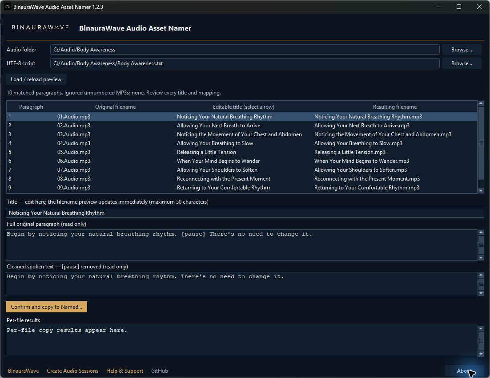

# BinauraWave Audio Asset Namer

A free, offline Windows desktop utility for turning numbered Audacity MP3 exports into descriptive, editable filenames. Pair your clips with a UTF-8 script, review the suggested titles, and copy the named audio into a fresh folder with a CSV manifest.

**Current source version: 1.2.6.** Original utility code is MIT-licensed; BinauraWave artwork and trademark rights are reserved separately.



The screenshot shows an earlier build with demonstration text. The layout and workflow remain the same.

## Features

- Match Audacity export numbers to script paragraphs, with numeric sorting and strict count/sequence validation.
- Treat blank-line-separated paragraphs as clips; retain full original text and remove literal `[pause]` markers only from titles/cleaned text.
- Suggest descriptive titles using deterministic, offline phrase extraction. Edit every suggestion before copying.
- Preview original filenames, paragraph numbers, final filenames and complete text.
- Export title-only MP3 filenames, preserving original bytes without re-encoding or changing audio tags.
- Create a UTF-8 CSV manifest with filenames, titles, category, original/cleaned text and original track numbers.
- Reject case-insensitive duplicate titles, unsafe names, changed inputs and existing output folders. Never overwrite or add automatic numeric suffixes.
- Use a lightweight dark Tkinter interface, local logo/icon and native dark Windows title bar where supported.

No account, API key, paid service, telemetry, automatic splitting, transcription or ElevenLabs integration is involved. Audio files and scripts remain on your computer. Only clicking a website link opens a browser.

## Install and run

### Windows executable

Download the Windows x64 ZIP from the [official GitHub Releases page](https://github.com/cmderdanblackburno7/audio_asset_namer/releases) when a release is available, extract it and double-click `BinauraWave-Audio-Asset-Namer.exe`. No Python, pip, Tkinter installation or administrator privileges are required. Keep the ZIP's licence/branding/third-party notices with the application when redistributing it.

The current executable is unsigned. Windows SmartScreen may show an unrecognised-app warning because a new unsigned publisher has little reputation. Do not bypass warnings for an unexpected download: check the official repository, release filename and checksum, or wait for a signed release. A checksum is an integrity check, not a code signature or a guarantee that antivirus products will trust the file.

The executable can run from an ordinary folder such as Desktop or Downloads. Its runtime extracts temporarily into Windows temp; user audio/CSV output goes only into `Named` beneath the audio folder you choose. The utility does not rely on another BinauraWave application, repository, website connection or development directory.

### From source

Install Python **3.10+** with Tcl/Tk support. From this checkout:

```powershell
python app.py
```

On Windows, `launch.bat` also works with a usable Python launcher or PATH installation. No `pip install` is needed to run the source app. Keep `favicon.ico`, `assets/logo.png` and the Python modules together; asset paths resolve relative to the application, not the working directory. Missing branding artwork falls back gracefully.

## Verify your download

Download `SHA256SUMS.txt` from the same official release as the ZIP. In Windows PowerShell, from the download folder:

```powershell
Get-FileHash .\BinauraWave-Audio-Asset-Namer-1.2.6-Windows-x64.zip -Algorithm SHA256
```

Compare **all 64 hexadecimal characters** in the output with the matching ZIP line in `SHA256SUMS.txt` (letter case does not matter). Stop if they differ and obtain a fresh copy from the official release. After extraction, you can also run `Get-FileHash .\BinauraWave-Audio-Asset-Namer.exe -Algorithm SHA256` and compare the EXE line. Checksums are calculated from the final files and reverified by the build; they detect corruption/changes when the checksum source is trusted.

## Usage

1. Manually split/export clips in Audacity into one folder, for example `01.First track.mp3`, `02.Audio 1.mp3` and `03.Audio 2.mp3`.
2. Save the matching script as UTF-8 `.txt`, one intended clip per paragraph separated by blank lines. Single line breaks stay inside their paragraph; `[pause]` markers do not split it.
3. Select the audio folder and script, then choose **Load / reload preview**.
4. Check every mapping, select rows to inspect the full text, and edit titles in the title field. Filename previews update immediately.
5. Choose **Confirm and copy to Named...**, check the destination, then review the per-file results.

Only immediate-child MP3s with leading ASCII digits followed by a period, space, underscore or hyphen are included; extension matching is case insensitive. Numbers must run exactly from **1 through the paragraph count**, with no gaps, duplicates or zero. Unnumbered MP3s are ignored and listed. The utility never guesses which paragraph belongs to which recording.

A valid sequence cannot prove the spoken content matches the script: verify the export order yourself. Suggestions use English-language heuristics, aim for 4–8 words within 50 characters, and can be imperfect. Review unfamiliar topics, pronouns, negation and short passages. Repeated suggestions require manual edits; titles must be unique without regard to case.

## Output and privacy

A new `Named` subfolder contains files such as `Noticing Your Natural Breathing Rhythm.mp3` and `manifest.csv`. Originals and the source script are retained unchanged. The selected audio folder's name becomes the initial category. An existing `Named` file or folder is refused, even if empty; inspect/move it aside before retrying. Interrupted or failed copies can leave partial output for inspection; the manifest records successful copies and the results panel reports each file.

The CSV columns are:

| Column | Meaning |
| --- | --- |
| `filename` | Final title-only MP3 basename |
| `title` | Reviewed title |
| `category` | Selected audio folder name |
| `full_original_text` | Full paragraph, including pause markers/internal line breaks |
| `cleaned_spoken_text` | Paragraph with `[pause]` removed and whitespace normalised |
| `track_number` | Original numeric export sequence, for example `01` becomes `1` |

The script's UTF-8 BOM and paragraph separators are structural; paragraph contents are preserved. Inputs are checked again before export. Very long Windows paths may require a shorter location. No files are uploaded. Do not include personal scripts, audio or manifests in bug reports without reviewing their contents. CSV preserves supplied text faithfully: import its columns as text when using a spreadsheet application, which could otherwise interpret formula-like text.

## Build a Windows executable

Use **64-bit Windows and the reviewed official PSF Python 3.13.17 runtime** with Tkinter, pip and venv support. From this checkout:

```powershell
py -3.13 build_windows.py --gui-smoke
```

Or double-click `build_windows.bat`. The release builder checks the exact Python version and native binary hashes in `licenses/runtime-provenance.json`; an old/custom runtime is refused. Move any old `.build-venv` into an ignored backup folder before changing runtimes. Other runtime versions need a fresh provenance/licensing review.

A project-local runtime can also be prepared without a system install: download the [official full runtime ZIP](https://www.python.org/ftp/python/3.13.17/python-3.13.17-amd64.zip), compare its SHA-256 with `archive_sha256` in the provenance file and the [PSF release manifest](https://www.python.org/ftp/python/3.13.17/windows-3.13.17.json), then extract it into `build/python-runtime`. Run `.\build\python-runtime\python.exe build_windows.py --gui-smoke`. The embeddable ZIP is a different package and lacks Tkinter.

 The script creates an ignored `.build-venv`, installs the exact build-only dependencies in `requirements-build.txt`, runs this checkout's tests, and builds with PyInstaller's one-file/windowed spec. Initial dependency installation needs package-index access. `--skip-install` reuses an already prepared environment; `--gui-smoke` needs an interactive desktop and can be omitted for regular tests.

Outputs go to ignored `dist/`: the executable, short README, versioned Windows-x64 ZIP and build/checksum report plus `SHA256SUMS.txt`. The ZIP includes source/branding licence notices and collected Python/Tcl/Tk/build-package notices. The build report also records the source commit and whether the source tree was dirty. A final release must be built from a clean reviewed commit. The source app has no additional runtime pip dependencies. `build/` holds temporary build data. No development fixtures, source audio, private application files or copied virtual environment are bundled. Unused XZ/LZMA decoding is explicitly excluded; bundled native files must match the reviewed PSF binaries.

Review [third-party requirements](THIRD_PARTY_NOTICES.md) and the [release test checklist](PACKAGING_TESTS.md) before publication. Compiled executables and ZIPs belong in **GitHub Releases**, never source commits. Build/publishing/signing are separate steps; these scripts do not push, upload or change Git remotes.

## Tests

```powershell
python tests/audio_asset_namer_regression.py
python tests/audio_asset_namer_regression.py --gui-smoke
python tests/release_packaging_regression.py
```

Tests and fixtures are included here and need no other repository, credentials, network service, real audio collection or paid API. Dummy audio bytes are sufficient to verify byte-copy behavior. The optional GUI smoke checks actual Tk controls, editing/export, contrast, keyboard traversal, layout, assets and native Windows branding.

## Links and support

- [BinauraWave](https://binaurawave.com/)
- [Create Audio Sessions](https://binaurawave.com/binaurawave_app/)
- [Help & Support](https://binaurawave.com/feedback/)
- [GitHub source and issues](https://github.com/cmderdanblackburno7/audio_asset_namer)

All four footer links are optional and open only when clicked; they cause no startup requests. Report ordinary bugs through [GitHub Issues](https://github.com/cmderdanblackburno7/audio_asset_namer/issues), with the version, Windows version, redacted error text and a tiny synthetic example. For security concerns, see [SECURITY.md](SECURITY.md) and contact support before posting sensitive details publicly. Do not send personal audio, full scripts, passwords, API keys or unredacted local file paths.

## Licence, branding and limitations

Original source code, tests, build scripts and original documentation are under the [MIT licence](LICENSE). This does not extend to the reserved BinauraWave name, trademarks, logo, favicon or branded artwork: see [BRANDING.md](BRANDING.md). Third-party components keep their own licences; see [THIRD_PARTY_NOTICES.md](THIRD_PARTY_NOTICES.md).

The workspace uses Tk's bundled `clam` theme and standard-library Windows APIs. Native file pickers and message dialogs follow OS styling; unsupported systems may keep a light title bar. Large text/high-DPI settings, clean-machine executable releases and browser associations need release-time checks. The fixed dark workspace does not automatically follow OS high-contrast preferences.

See [RUNTIME_SECURITY.md](RUNTIME_SECURITY.md) for the dated native-library/advisory review and [RELEASE_READINESS.md](RELEASE_READINESS.md) for exact artifact identities and performed checks. A separate Windows 10 laptop successfully processed 10 real MP3s in the previous 1.2.6 build, as reported by its owner. Its occasionally light title bar until focus is a cosmetic limitation. Runtime-refreshed artifacts need their own checks; the report distinguishes these builds.

See [CHANGELOG.md](CHANGELOG.md) for version history. This standalone utility contains no commercial BinauraWave application code.
